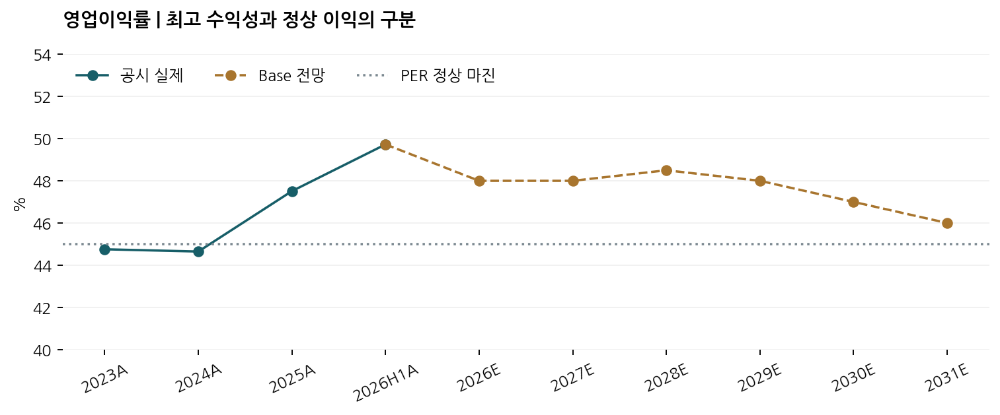
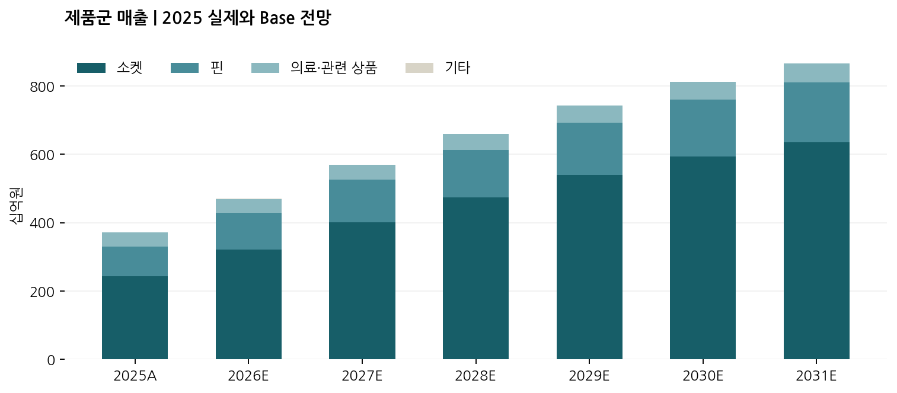
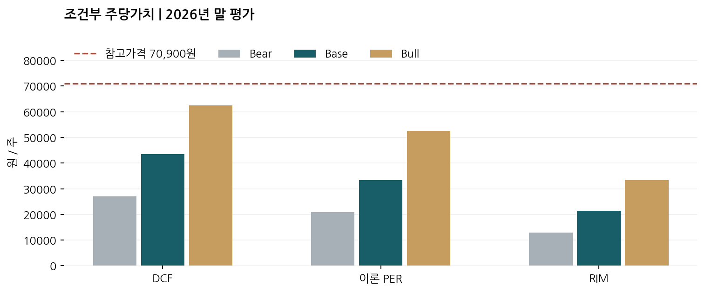

# [리노공업 기업분석 포트폴리오]

**2026-10-19 상세 보고서 v1** · 제품별 매출에서 투자·현금 회수·주당가치까지 산정 근거를 기록했습니다.

|읽기|파일|
|---|---|
|전체 보고서|[산업·기업·재무·PER·RIM·DCF](report/FINAL_REPORT.md)|
|PDF|[상세 투자 분석 보고서](report/Equity_Research_Report.pdf)|
|Excel|[12개 시트의 편집 가능한 수식 모델](model/Equity_Research_Model.xlsx)|
|산정 근거|[가정별 근거와 수정 조건](research/ASSUMPTION_LEDGER.md)|
|입력과 출처|[단일 입력 JSON](data/research_inputs.json) · [공시 계정 대사](data/actuals_audit.csv) · [출처](data/source_register.csv)|
|검증|[수식 대조](model/model_validation.json) · [추가 검증](model/review_validation.json)|

## [같은 형식으로 읽는 기업]

|기업|저장소|
|---|---|
|삼양식품|[samyang-foods-equity-research](https://github.com/tobynn/samyang-foods-equity-research)|
|에스앤에스텍|[s-and-s-tech-equity-research](https://github.com/tobynn/s-and-s-tech-equity-research)|
|티씨케이|[tck-equity-research](https://github.com/tobynn/tck-equity-research)|
|삼성전자|[samsung-electronics-equity-research](https://github.com/tobynn/samsung-electronics-equity-research)|
|SK하이닉스|[sk-hynix-equity-research](https://github.com/tobynn/sk-hynix-equity-research)|

## [폴더 안내]

```text
data/       공시 실제치·가정·제품 성장·계정 대사·출처
report/     14개 공통 목차 본문·PDF·그림
model/      Excel·전망·연결표·결과·검증
scripts/    본문·모델·그림·PDF 재생성
research/   가정별 사실·선택 이유·수정 조건
```

실제 재무제표는 별도 기준입니다. 제품 매출·회수일수·배당 지급 시점을 리노공업에 맞춰 연결했습니다. 관측 TTM 비교는 ISC 1곳이며 정상 forward peer 평균 배수로 사용하지 않습니다. WACC와 자기자본비용은 명시한 시나리오 조건입니다.

아래는 보고서 전문입니다. README의 그림은 report/figures 원본을 사용합니다.

---

# [리노공업 기업분석 | 실적에서 주당가치까지]

> 테스트 부품의 수익성과 증설 후 현금 회수로 설명하는 기업가치

발간·모델 수정일 2026-10-19 | 정보 확인일 2026-10-19 | 실제 재무제표 2026-06-30 | 평가 대상 시점 2026-12-31E | 금액 십억원, 주가 원/주

## [01. 투자 판단과 예상주가]

리노공업의 투자 논점은 고사양 테스트 소켓의 매출 확대가 증설·인건비·연구개발비를 지불한 뒤에도 높은 자본수익률을 유지하는지다. 본 보고서는 제품별 매출에서 출발해 현금 회수와 성장 투자 부담을 계산한다. 기술 경쟁력은 확인할 근거와 가치에 반영할 기간을 함께 제시하며, 현재 주가를 설명하는 데 필요한 조건도 역산한다.

| 방법 | Bear | Base | Bull | 계산의 역할 |
| --- | --- | --- | --- | --- |
| DCF | 27,100원 | 43,400원 | 62,400원 | 중심 시나리오: 투자 이후 영업현금흐름 |
| PER | 20,900원 | 33,400원 | 52,500원 | 정상화 EPS와 이론 배수의 교차검증 |
| RIM | 12,900원 | 21,300원 | 33,300원 | 장부자본과 초과 ROE의 지속성 |

본 보고서의 중심 산출값은 **DCF Base 43,400원**, DCF 시나리오 범위는 **27,100원~62,400원**다. 모두 2026년 말 조건부 적정주가이며, 12개월 후 거래가격의 통계적 예측이나 증권사 컨센서스가 아니다. 각 시나리오의 확률은 추정하지 않았다. 전망의 매출·마진·투자 경로가 성립할 때의 값이다.

가격 비교에는 기존 보고서와 같은 날짜의 **2026-10-16 NAVER 일별시세 참고 종가**를 사용했다. 이 기업의 참고가는 **70,900원**, DCF Base와의 차이는 **-38.8%**다. 배당을 제외한 연말 시나리오 가격차이며 확률적 기대수익률이 아니다. KRX 공식 종가와의 대사는 완료되지 않았고, 리노공업의 한국경제 시세 페이지 70,800원과 100원 차이가 있어 공급사 차이를 기록했다. 공급사 가격을 섞지 않았다. 시가총액·매수 등급은 제시하지 않는다. [PX01](https://api.finance.naver.com/siseJson.naver?symbol=058470&requestType=1&startTime=20261016&endTime=20261016&timeframe=day)

세 방법은 할인율·성장·분배 가정을 공유한다. PER와 RIM은 독립적인 시장 증거로 세지 않으며 평균 목표가를 만들지 않는다. 소형기업의 시장가격이 기본 사업 가치와 다르면 미확인 신규 사업의 가치나 이익 지속성에 관한 추가 가정을 확인해야 한다. 해당 가격 차이만으로 시장가격이 틀렸다고 결론 내리지 않는다.

핵심 반증은 상위 고객의 설계 변경·소켓 채택 감소이다. 다음 실적에서는 이 조건과 현금 회수를 먼저 확인한다. 핵심 실적의 원자료는 [S01](https://dart.fss.or.kr/report/viewer.do?rcpNo=20260814000445&dcmNo=11527283&eleId=21&offset=272052&length=94997&dtd=dart4.xsd)에서 확인할 수 있다.

**[이번 점검의 판단]** 장기 신규 투자의 초과 ROIC를 0으로 둔 DCF는 41,200원다. 순현금의 낮은 수익률을 분리한 RIM 민감도는 9,300원로 기존 RIM과 차이가 난다. 기존 Base의 산식과 숫자는 보존하고, 이 차이를 조건부 가치의 핵심 한계로 명시했다. 같은 이론 PER를 고정해 참고가격을 설명하려면 정상 영업이익률 97.6%가 필요하다. 이는 신규 전망이나 관측 시장 프리미엄이 아니다. 자세한 전환 가정과 기업별 수치 점검은 09·11절을 따른다.

## [02. 평가기준일·자료기준일·가정 버전]

| 항목 | 이번 보고서 기준 | 처리 방식 |
| --- | --- | --- |
| 발간·모델 버전 | 2026-10-19 / research-v1 | 보고서·CSV·Excel·PDF 동일 입력 |
| 정보 확인일 | 2026-10-19 | 원자료 발표일과 분리 |
| 재무상태 기준일 | 2026-06-30A | 실제 현금·부채·지배주주 자본 |
| 평가 대상 시점 | 2026-12-31E | 하반기 이익·투자·배당을 연결 |
| 명시 전망 | 2026E 및 2027E~2031E | 2026년은 실제 H1과 추정 H2 |
| 잔존가치 시작 | 2032년 | 정상 성장·ROIC·ROE 적용 |
| 참고 종가 | 2026-10-16 / NAVER 일별시세 | 공급사별 차이 기록; 거래소 확정값 미대사 |
| 정량 peer 배수 | ISC 1곳의 관측 TTM 대조 | 정상 forward EPS·평균 배수 미산정 |

Valuation vintage라는 표현은 평가에 쓴 정보 묶음과 추정치의 버전을 뜻할 때 사용한다. 독자에게는 평가기준일·자료기준일·가정 버전으로 적는 편이 명확하다. 기술 상업화 단계, 프리미엄, 할인율은 각각 별도 개념이다. 이번 문서의 발간일을 과거 자료의 발표일로 바꾸지 않는다.

2026년 말 적정주가는 현 시점 가치와 날짜가 다르다. 6월 말 자본에 하반기 전체 이익을 더하는 계산은 연말 평가를 위한 것이다. 연말 현금에 2026년 전체 FCFF를 다시 더하지 않으며, 연말 DCF에는 2027년 이후 현금흐름만 할인한다. 실제 연말 공시 전까지 현금·자본 연결표의 하반기 부분은 분석자 추정이다.

## [03. 산업 분석과 이익이 결정되는 과정]

반도체 테스트 부품 수요는 칩 생산량 외에 개발 중인 칩의 종류, 패키지와 접점의 사양, 시험 조건, 제품 교체주기에 영향을 받는다. 검사를 수행하는 장비, 검사 서비스를 제공하는 사업자, 칩과 장비의 접촉을 담당하는 소켓·핀 제조사는 매출 발생 조건과 투자 부담이 다르다. 리노공업은 소모성 접촉 부품의 설계·가공·조립·납기 대응을 평가하는 대상이다. 회사 반기보고서 II.2는 소켓과 핀의 용도를 구분한다. [S03](https://dart.fss.or.kr/report/viewer.do?rcpNo=20260814000445&dcmNo=11527283&eleId=11&offset=121311&length=8405&dtd=dart4.xsd)

공시는 약 3만 종의 주문제작 제품을 설명하며, 개발 당시 부가가치가 높고 시간이 지나면 가격이 하락할 수 있다고 적는다. 이에 따라 고사양 신제품의 구성비가 증가하는 효과와 기존 제품 가격이 낮아지는 효과를 함께 고려한다. 반도체 산업 매출 증가율을 회사 성장률로 그대로 대입하지 않는다. 제품별 판매량과 평균 단가는 공개 범위가 제한돼 있어 제품군 매출 성장으로 모델을 시작한다. [S03](https://dart.fss.or.kr/report/viewer.do?rcpNo=20260814000445&dcmNo=11527283&eleId=11&offset=121311&length=8405&dtd=dart4.xsd)

고속·고전력·미세 접점에 대응하는 기술은 프리미엄 후보다. 반기 연구개발 항목에는 SI/PI 성능 개선, 55µm Pitch 대응, 수냉식 Lid와 15,000핀 이상 Large Device Socket 연구가 등장한다. 연구계획과 실제 양산 매출은 각각 확인해야 한다. 본 모델에는 특정 AI 고객, 독점 계약, 수율 또는 점유율을 임의로 넣지 않았다. [S10](https://dart.fss.or.kr/report/viewer.do?rcpNo=20260814000445&dcmNo=11527283&eleId=15&offset=185281&length=49564&dtd=dart4.xsd)

위 문단의 수요·가격·원가 연결은 공개된 사업 특성을 바탕으로 한 분석자의 해석이다. 총주소시장(TAM), 점유율, 고객별 단가가 공개되지 않은 부분에는 임의 숫자를 채우지 않았다. 산업 성장이 회사의 동일 성장률을 보장한다는 가정도 사용하지 않는다.

## [04. 기업 분석과 사업별 확인 항목]

| 사업 | 수익의 출발점 | 확인할 항목 | 모델 처리 |
| --- | --- | --- | --- |
| IC TEST SOCKET | 반도체 테스트 패키지용 소모성 부품 | 신규 설계 채택·제품 난도·교체·납기 | H1 매출 166.384 / 68.48% |
| LEENO PIN | 반도체·PCB 전기 불량 검사 접촉 부품 | 소켓과 외부 판매 구분·제품 구성 | H1 매출 56.487 / 23.25% |
| 의료기기 및 관련 상품 | 초음파 프로브 등 부품 | 고객별 주문·검수·상품 매출 | H1 합계 20.031 / 8.25% |
| 기타 상품 | 반도체 관련 상품 | 제품 매출과 구분 | H1 0.057 / 0.02% |

2026H1 소켓 비중은 68.48%로 2025년 65.48%, 2024년 61.77%에서 상승했다. 소켓의 매출 확대는 관찰한 사실이다. 소켓의 개별 영업이익률, AI 매출 비중, 고객별 개발용·양산용 매출은 공개 표에 없다. 따라서 소켓 매출 비중의 증가만으로 총마진 개선의 원인을 확정하지 않는다. 소켓 매출에 내부 조립용 핀 생산량을 다시 매출로 더하지 않으며 제품별 외부 매출 합계를 재무제표 매출에 대사한다. [S03](https://dart.fss.or.kr/report/viewer.do?rcpNo=20260814000445&dcmNo=11527283&eleId=11&offset=121311&length=8405&dtd=dart4.xsd)

2025년 감사 재무제표와 2026H1 검토 재무제표는 별도 기준이고 연결대상 종속회사가 없다. RIM 자본과 순이익에 비지배지분을 혼합할 문제가 발생하지 않는다. 2025년 5대1 액면분할 이후 경제적 주식수는 75,895,600주이며, 과거 EPS도 동일 분할 기준으로 맞춰야 한다. 분할 전 EPS와 분할 후 가격을 섞으면 PER가 약 5배 왜곡될 수 있다. [S04](https://kind.krx.co.kr/external/2026/03/18/000195/20260318000896/11011.htm)

무차입에 가까운 재무상태와 큰 금융자산은 영업 기술력과 분리해서 평가한다. H1 현금 86.772와 유동 금융자산 340.042에서 리스부채 0.212를 차감한 순현금은 426.601이다. 비유동 금융자산 21.483 중 ELS 20.329는 예금과 위험이 다르다. 반복 EPS에는 정상 이자수익을 사용하고 평가손익·잡이익·환율손익은 재발한다고 가정하지 않는다. [S02](https://dart.fss.or.kr/report/viewer.do?rcpNo=20260814000445&dcmNo=11527283&eleId=26&offset=367053&length=999375&dtd=dart4.xsd)

기업 분석의 판단은 다음 순서를 따른다. 제품·사업의 수익원이 무엇인지 확인하고, 판매량·가격·원가·고정비가 손익으로 이어지는 과정을 설명한다. 이후 투자와 운전자본을 차감해 현금 회수를 점검한다. 마지막으로 이 수익이 자본비용을 넘는 기간을 PER와 RIM에 반영한다. 같은 성장 요인을 매출 성장과 별도 프리미엄에 반복 반영하지 않는다.

## [05. 실제 실적과 재무제표 점검]

| 기간 | 매출 | 영업이익 | 순이익(전체) | 영업이익률 | 출처 |
| --- | --- | --- | --- | --- | --- |
| 2023A | 255.6 | 114.4 | 110.9 | 44.8% | [S04](https://kind.krx.co.kr/external/2026/03/18/000195/20260318000896/11011.htm) |
| 2024A | 278.2 | 124.2 | 113.3 | 44.6% | [S04](https://kind.krx.co.kr/external/2026/03/18/000195/20260318000896/11011.htm) |
| 2025A | 372.5 | 177.0 | 152.0 | 47.5% | [S04](https://kind.krx.co.kr/external/2026/03/18/000195/20260318000896/11011.htm) |
| 2025H1A | 190.9 | 88.4 | 70.5 | 46.3% | [S01](https://dart.fss.or.kr/report/viewer.do?rcpNo=20260814000445&dcmNo=11527283&eleId=21&offset=272052&length=94997&dtd=dart4.xsd) |
| 2026H1A | 243.0 | 120.8 | 106.3 | 49.7% | [S01](https://dart.fss.or.kr/report/viewer.do?rcpNo=20260814000445&dcmNo=11527283&eleId=21&offset=272052&length=94997&dtd=dart4.xsd) |

A는 공시 실제치, P는 회사 잠정 발표, E는 분석자 추정이다. 반기·분기와 연간을 같은 길이의 기간으로 비교하지 않는다. 손익 표는 리노공업 별도 기준이고 연결대상 종속회사·비지배지분이 없어 같은 순이익과 자본을 RIM에 사용한다. 소수점 반올림으로 합계 차이가 생길 수 있다.

| 2026H1 기준 | 값 | 정의 |
| --- | --- | --- |
| 지배주주 자본 | 776.8 | RIM 출발값; 비지배지분 제외 |
| 비지배지분 | 0.0 | DCF 지분가치에서 장부금액 대용 차감 |
| 현금및현금성자산 | 86.8 | 현금성 자산 계정 |
| 포함 단기금융·투자자산 | 340.0 | 회사별 원문 범위 확인 |
| 차입금·사채 | 0.0 | 이자부 부채 |
| 추가 차감 리스부채 | 0.2 | 이미 차입금에 포함된 경우 0 |
| 순현금 | 426.6 | 현금+포함 금융자산-차입금-추가 리스 |
| 핵심 영업운전자본 | 114.4 | 매출채권+재고-매입채무 |
| 영업현금흐름 | 68.5 | 공시 분류 그대로; 배당 분류 주의 |
| 모델 취득액 기준 | 41.8 | 공시 PP&E 취득; 회사별 무형 포함 범위 명시 |
| 기초 경제적 주식수(백만주) | 75.895600 | 자기주식 제외; 삼성 보통+우선 |

순현금은 86.8 + 340.0 - 0.0 - 0.2 = 426.6다. 기타금융자산 전체를 현금으로 간주하지 않았다. 비유동 금융자산 별도 가산액은 21.5이며 매각세금·실현 가능성은 별도 민감도로 다룬다. [S01](https://dart.fss.or.kr/report/viewer.do?rcpNo=20260814000445&dcmNo=11527283&eleId=21&offset=272052&length=94997&dtd=dart4.xsd)



### [실제 이익과 현금 회수의 차이]

H1 매출은 전년 동기 대비 27.2%, 영업이익은 36.7% 증가했다. 영업현금흐름/순이익은 **64.5%**다. H1 영업현금 68.533에서 유형·무형 현금 취득 41.843을 빼면 참고 현금 잉여는 **26.689십억원**이다. 이 값은 공시 현금흐름 분류를 유지한 실제치이며, 정상 세금·이자·영업운전자본으로 재구성한 전망 FCFF와 정의가 다르다. H1 순이익 106.319가 전부 같은 기간 현금으로 들어온 것으로 해석하지 않는다. [S01](https://dart.fss.or.kr/report/viewer.do?rcpNo=20260814000445&dcmNo=11527283&eleId=21&offset=272052&length=94997&dtd=dart4.xsd)

| H1 현금흐름을 움직인 항목 | 십억원 | 해석 |
| --- | --- | --- |
| 매출채권 증가의 현금흐름 효과 | -46.811231304 | 매출 인식과 현금 회수의 시차 |
| 재고 증가 | -4.974621206 | 선행 생산·재고 구성 확인 |
| 미지급비용 증가 | 23.665235726 | 비용 발생과 현금 지급의 시차 |
| 예수금 감소 | -11.7447568 | 일시적 지급 항목; 전년과 비교 |
| 현금 세금 납부 | -30.113083637 | 손익 세금 비용 33.537과 시점 차이 |

현금흐름 주석의 매출채권 증가와 재무상태표의 AR 증가액은 외화 환산·분류 등의 영향으로 다르다. 전망 NWC는 재무상태표 잔액을 사용하고 실제 CFO 설명은 현금흐름 주석을 사용한다. 두 표의 차이를 누락이나 회수 손실로 단정하지 않는다. 미지급비용은 성과급 전체 금액으로 확인된 항목이 아니므로 정산 가정의 명칭을 그대로 유지한다.

## [06. 실적 전망과 가정의 근거]

2026년은 H1 실제 242.959에 제품군별 H2 추정을 더한다. Base H2는 소켓 155.0·핀 51.5·의료 및 관련 상품 20.5·기타 0.06이다. H1을 두 배로 연율화한 매출보다 낮은 경로로 두어 생산 이전·작업 조건·고객 검수의 하반기 부담을 점검한다. 이는 회사의 하반기 주문잔고나 확정 출하계획이 아니다. 소켓 H2 155는 H1 166.384의 93.2%, 핀 51.5는 H1 56.487의 91.2%를 가정한 숫자다. 공개된 H2 고객별 계약물량으로부터 계산된 값이라고 표시하지 않는다.

2027년 성장의 출발점은 제품군별 2026E다. Base는 소켓 25%·핀 15%·의료 8%·기타 0% 성장으로 구성한다. 소켓은 2025년 제품군 매출의 높은 증가와 H1 구성비 상승이 근거 후보이며, 25% 자체는 분석자가 설정한 조건이다. 핀은 소켓과의 내부 수요 중복을 피하고 외부 매출만 15% 성장시킨다. 의료는 반도체 고객 수요와 구분해 8%를 적용한다. 2028~2031년 성장률은 신공장 가동 초기 효과의 소진과 기존 제품의 가격 하락 가능성을 반영해 낮춘다. 제품별 5개 연도 성장률과 매출 연결은 추가 표와 Operating Build 시트에서 모두 확인할 수 있다.

Base 2026E 영업마진 48.0%는 H1 49.73%와 2025년 47.51%를 함께 본 값이다. H2만의 영업마진은 이 연간 가정에서 H1 실제 영업이익을 빼 역산한다. 2027년은 48.0%, 2028년 48.5%, 이후 48.0%·47.0%·46.0%로 둔다. 제품 구성 개선과 가동 초기 비용이 동시에 있을 수 있어 H1 최고 수익성을 영구 적용하지 않는다. PER 정상 마진 45%는 2023~2024년 약 44.7% 수준을 기준으로 최근 제품 구성을 일부 인정한 조건이다. 정상 EPS는 2027년 보고 EPS와 다르다.

CAPEX는 2026년 80·2027년 45·2028년 45·2029년 48·2030년 50·2031년 52다. 반기 생산설비 표의 건설·장비 총 소요 97.182와 기지출 78.554의 차이는 18.628이다. 이는 해당 프로젝트의 남은 계획 금액이며 회사 전체 연간 CAPEX가 아니다. 이미 납부한 토지대금 74.514는 향후 투자에 재차 넣지 않는다. Base 2026H2 투자 38.157에는 남은 프로젝트 18.628과 다른 설비·무형 투자 및 집행 시차에 대한 추가 가정 19.529가 들어 있다. 추가 금액은 계약 확정치가 아니며 Bear/Bull에 집행 변동을 반영한다.

D&A 2026년 15.5·2027년 21·2028년 24·2029년 27·2030년 30·2031년 33을 사용한다. H1 유형자산 주석 상각 6.781와 무형 상각 0.162를 합친 6.943이 기초다. 현금흐름 조정의 D&A 6.673에는 경상개발비로 분류된 상각 0.270이 별도 항목에 있어 이 금액을 합쳐야 EBIT 기준 전체 비현금 상각과 맞는다. 건설중인자산 157.665에는 이미 납부한 토지 74.514가 포함돼 전액을 감가상각하지 않는다. 신공장의 정확한 자산별 내용연수·본계정 대체 일정이 없어 D&A 경로는 확정 회계예산이 아니다.

운전자본은 임의 매출 비율 대신 DSO·DIO·DPO와 매출원가율로 구성한다. NWC/매출 = DSO/365 + 매출원가율×(DIO-DPO)/365다. Base 2026은 DSO 65일·DIO 32일·DPO 12일이며 2027 DSO 63일, 이후 60·58·58·58일로 회수가 개선되는 조건이다. H1 기말 AR를 H1 매출로 연율화한 회수일수는 약 76.4일로 2025년 말 약 51.8일보다 길다. 기말 잔액 기반 대용치이므로 실제 계약상 결제기일과 구분한다. 회수 개선이 확인되지 않으면 Bear의 75일대 경로로 수정한다.

H1 미지급비용은 전기말 7.352에서 31.017로 23.665 증가했다. 핵심 NWC가 AR·재고·AP만 포함하므로 이 미지급비용의 H2 정산을 별도 현금조정 -23.665로 반영한다. 발생 비용을 손익에 다시 차감하지 않는다. 지급일이나 항목 전체가 성과급이라는 사실은 공시에서 확인되지 않았다. 이 가정은 연말 미지급비용을 전기말 수준으로 되돌리는 현금 조건이다. 2027년 이후 잔액이 안정된다고 두고 추가 연간 정산 충격은 0이다.

현금 세후 수익률 1.8%는 H1 이자수익 5.213을 전기말·반기말 현금+유동 금융자산의 평균 441.029로 나눠 연율화한 약 2.36%에 정상 세율 24%를 적용한 약 1.80%를 반올림했다. 이는 만기별 예금 금리·향후 회사채 수익률의 확정치가 아니다. ELS 평가이익, FX 손익, 잡이익은 정상 이익에서 제외한다. H1 세율 33.537/139.856 약 23.98%를 근거로 정상 세율 24%를 썼으며 해외·세액공제·이연법인세가 바뀌면 갱신한다.

배당은 최근 3개년 실제 약 40% 성향을 기준으로 40%를 가정한다. 결산배당이 다음 해 지급되는 회사의 관행에 맞춰 2027년 배당은 2026E 순이익×40%, 2028년은 2027E 순이익×40%로 연결한다. H2 추가 배당은 0이다. 2026H1에 이미 지급한 2025년 배당 60.716을 H2에서 다시 차감하지 않는다. 자사주 신규 매입·증자·추가 OCI는 0이라는 조건이며 실제 발생 시 현금·자본·주식수를 함께 수정한다. 회사의 2026-03-26 계획은 DPS 800원 이상·배당성향 30% 이상 목표다. 모델의 40%는 최근 실제 배당성향을 따른 분석자 조건이며 회사가 40%를 보장한 것으로 표시하지 않는다.

| 십억원 | 2026E | 2027E | 2028E | 2029E | 2030E | 2031E |
| --- | --- | --- | --- | --- | --- | --- |
| 매출 | 470.0 | 569.8 | 660.1 | 743.2 | 811.9 | 865.5 |
| 영업이익률 | 48.0% | 48.0% | 48.5% | 48.0% | 47.0% | 46.0% |
| 영업이익 | 225.6 | 273.5 | 320.1 | 356.7 | 381.6 | 398.1 |
| 지배주주 순이익 | 189.8 | 216.4 | 253.6 | 283.9 | 305.5 | 320.9 |
| EPS(원) | 2,500.8 | 2,851.6 | 3,342.1 | 3,740.1 | 4,024.8 | 4,228.1 |
| D&A | 15.5 | 21.0 | 24.0 | 27.0 | 30.0 | 33.0 |
| CAPEX | 80.0 | 45.0 | 45.0 | 48.0 | 50.0 | 52.0 |
| 핵심 NWC | 95.9 | 113.2 | 125.5 | 137.4 | 150.6 | 161.0 |

정상 세율 24.0%와 순현금 세후 수익률 1.8%는 분석자 가정이다. 현재 세법에서 확정된 세율이나 회사 가이던스로 표시하지 않는다. 해외 법인·세액공제·이연법인세·환율 때문에 보고 세율과 다를 수 있다. 2026년 순이익은 H1 실제 지배주주 순이익에 H2의 세후 영업이익과 정상 이자수익을 더한다. 이후 순이익은 세후 영업이익의 지배주주 귀속 추정분과 순현금 수익으로 만든다. 금융상품 평가손익·OCI는 0으로 가정한다. 미래 지배주주 귀속 비율은 반기 지배주주 순이익/반기 전체 순이익으로 추정하되, 비지배지분 손실로 비율이 100%를 넘으면 100%로 제한했다. 미래 자회사별 수익성이 달라질 수 있어 이 비율은 회사 확정치가 아니다.

매출 전망은 관찰 가능한 실적과 사업 조건을 반영한 집계 경로다. 고객별 계약물량, 정확한 제품별 ASP·수율이 모두 공개된 수량 기반 예산은 아니다. 해당 미공개 수치를 임의로 만들어 정밀한 물량 모델로 포장하지 않았다. 가정별 근거와 실제 확인 조건을 다음 시나리오 표에 남겼다.



### [제품별 매출을 합치는 과정]

| 십억원 | H1 실제 | H2 Bear | H2 Base | H2 Bull |
| --- | --- | --- | --- | --- |
| 소켓 | 166.384 | 133.000 | 155.000 | 173.000 |
| 핀 | 56.487 | 45.000 | 51.500 | 58.000 |
| 의료·관련 상품 | 20.031 | 18.000 | 20.500 | 21.500 |
| 기타 상품 | 0.057 | 0.050 | 0.060 | 0.070 |

| Base 제품군 성장률 | 2027 | 2028 | 2029 | 2030 | 2031 |
| --- | --- | --- | --- | --- | --- |
| 소켓 | 25.0% | 18.0% | 14.0% | 10.0% | 7.0% |
| 핀 | 15.0% | 12.0% | 10.0% | 8.0% | 6.0% |
| 의료·관련 상품 | 8.0% | 7.0% | 6.0% | 5.0% | 4.0% |
| 기타 상품 | 0.0% | 0.0% | 0.0% | 0.0% | 0.0% |

| Base 매출, 십억원 | 2026 | 2027 | 2028 | 2029 | 2030 | 2031 |
| --- | --- | --- | --- | --- | --- | --- |
| 소켓 | 321.4 | 401.7 | 474.0 | 540.4 | 594.4 | 636.1 |
| 핀 | 108.0 | 124.2 | 139.1 | 153.0 | 165.2 | 175.1 |
| 의료·관련 상품 | 40.5 | 43.8 | 46.8 | 49.6 | 52.1 | 54.2 |
| 기타 상품 | 0.1 | 0.1 | 0.1 | 0.1 | 0.1 | 0.1 |

2026E 각 제품 매출 = H1 실제 + H2 추정. 이후 제품 매출 = 전년 같은 제품 매출 × (1+그 제품 성장률). 전체 매출은 네 제품군 합계다. 총매출에 별도 AI 성장률을 다시 곱하지 않는다. 제품 구성과 전체 매출을 구분하기 위해 수요를 출하량·단가로 나누는 설명은 유지하되, 공개되지 않은 고객별 수량과 ASP는 입력하지 않았다. 생산실적 EA는 판매량이 아니며 소켓 안에 들어간 핀의 내부 수량과도 중복될 수 있다.

제품군별 25%·15%·8%는 회귀분석으로 식별한 인과 계수나 회사 가이던스가 아니다. 소켓 비중 상승·설비 투자·기술개발이 성장 가능성을 뒷받침하는 사실이고, 각 수치는 이를 어느 정도 인정할지 정한 분석자 조건이다. Bear는 소켓 14%·핀 8%·의료 4%, Bull은 32%·20%·12%를 2027년에 적용한다. 다음 제품별 실제 매출이 어느 경로에 접근하는지 확인해 조건을 수정한다.

### [회수일수·투자·할인율의 산정 근거]

| Base 입력 | 2026 | 2027 | 2028 | 2029 | 2030 | 2031 |
| --- | --- | --- | --- | --- | --- | --- |
| DSO, 일 | 65.0 | 63.0 | 60.0 | 58.0 | 58.0 | 58.0 |
| DIO, 일 | 32.0 | 32.0 | 32.0 | 32.0 | 32.0 | 32.0 |
| DPO, 일 | 12.0 | 12.0 | 12.0 | 12.0 | 12.0 | 12.0 |
| CAPEX | 80.0 | 45.0 | 45.0 | 48.0 | 50.0 | 52.0 |
| D&A | 15.5 | 21.0 | 24.0 | 27.0 | 30.0 | 33.0 |

DSO 실제 대용치는 2025년 말 **51.8일**, H1 매출을 두 배로 본 2026년 6월 말 **76.4일**이다. 평균 AR와 매일의 매출을 사용한 정확한 회전일수가 아니다. Base 2026년 65일은 두 실제 기말 지표 사이에서 일부 회복을 가정한 조건이고, 2027년 63일도 실제 회수가 개선돼야 성립한다. 반기 말 매출 집중과 환율의 영향을 확인할 때까지 75일대 Bear를 유지한다. DIO와 DPO도 기말 잔액 대용치로 검증하고, 32일·12일은 주문제작 생산의 재고와 짧은 매입 신용을 반영한 범위 가정이다.

매출원가율 = 1-영업이익률-판관비율이다. Base 판관비율 4.5%를 사용하며, 2027년 매출원가율은 47.5%다. NWC/매출 = DSO/365 + 매출원가율×(DIO-DPO)/365이므로 2027년 NWC 비율은 19.9%다. 판관비율은 H1 약 3.93%에서 교육·연구·관리 부담을 더 인정한 조건이다. 제품별 원가를 공시하지 않아 소켓 1개당 원가와 핀 1개당 원가를 역산하지 않았다. 이 비용 가정이 공개된 견적표라는 뜻도 아니다.

공장 계획상 남은 건설·장비 투자 18.628를 2026H2 CAPEX 38.157에 포함했고, 차이 19.529는 다른 설비·무형 투자와 시점 조정에 대한 분석자 예산이다. 2027년 CAPEX 45와 D&A 21의 차이 24는 신규 투자다. 이 현금 지출에 NWC 증가를 더해 재투자액을 만든다. 증설은 현금 투입 시점과 매출 기여 시점이 다르므로 프로젝트 잔여 금액을 곧바로 매출로 환산하지 않는다.

WACC와 자기자본비용은 Bear 11.5%·Base 10.5%·Bull 9.5%로 같게 둔다. 공시상 차입금은 없고 리스부채도 약 0.212여서 유의적인 부채 조달 비중을 가정해 WACC를 인위적으로 낮출 근거가 약하기 때문이다. 이 범위는 고객 집중·기술 대체·생산 이전의 불확실성을 점검하는 요구수익률 조건이다. 동일 날짜의 무위험금리·추정 베타·ERP·목표 자본구조를 모두 확보한 CAPM은 아직 산정하지 않았다. 따라서 10.5%를 시장에서 직접 관측한 할인율로 표시하지 않는다. ±1%p 표에서 결과가 얼마나 변하는지 함께 판단한다.

성숙 성장률 2.5%는 원화 명목 장기 조건이며 회사의 현재 성장률을 영구 연장한 값이 아니다. 성숙 ROIC 15%와 WACC 10.5%의 차이는 4.5%p다. 높은 현재 수익성이 계속되더라도 경쟁·가격·추가 투자에 의해 초과수익이 줄어드는 조건을 둔다. 이 15%는 새 공장의 개별 투자수익률을 공시에서 확인한 값이 아니다. 성숙 ROIC=WACC의 소멸 경로와 함께 읽어야 한다. 성숙 ROE 12%는 현금을 포함한 장부자본에 적용되는 별도 조건이며 현금 축적에 따른 하락 부담은 RIM 민감도에서 점검한다.
### [기존 영업자본과 신규 투자수익률의 구분]

| 연도 | 기초 영업자본 대용, 십억원 | NOPAT/기초 영업자본 |
| --- | --- | --- |
| 2027 | 363.4 | 57.2% |
| 2028 | 404.7 | 60.1% |
| 2029 | 438.0 | 61.9% |
| 2030 | 470.9 | 61.6% |
| 2031 | 504.1 | 60.0% |

영업자본 대용치는 주주자본-순현금-별도 가산 비영업자산으로 구했다. 계정별 영업자산·부채를 모두 분리한 확정 투하자본과는 차이가 있다. 특히 미지급비용·연금·이연세금의 분류와 회계상 인식하지 않은 기술·고객 기반의 영향을 받는다. 위 높은 수익률은 현재 마진과 비교적 낮은 순투자가 유지된다는 명시기간 가정의 결과다. 새 공장의 실제 수익률을 직접 측정한 수치가 아니다.

DCF 잔존가치의 g/ROIC 식에서 15%는 성숙기에 추가로 투입하는 자본의 한계수익률 조건으로 해석한다. 2031년까지 형성된 영업자산의 높은 수익성을 2032년에 모두 15%로 재설정한 것은 아니다. 신규 투자 ROIC=WACC만 적용해도 기존 자산의 이익은 남을 수 있다. 따라서 이 민감도를 전체 경쟁우위가 사라지는 가치로 부르지 않는다. 기존 영업자산까지 초과수익을 잃는 조건은 다음 별도 표에 제시한다.

### [가정별 증거와 변경 조건]

| 판단할 가정 | 확인한 자료·성격 | 현재 모델 연결 | 추가 확인·변경 조건 |
| --- | --- | --- | --- |
| 소켓 중심 성장 | H1 소켓 166.384, 68.48%; S03 | 제품군별 성장으로 2027 전체 매출 구성 | 고객 채택·출하·실제 제품 매출로 25% 조건 수정 |
| 마진 유지 | 2023~25와 H1 손익 S01·S04 | 정상 45%, 명시기간 46~48.5% Base | 신공장 D&A·인건비·제품 구성 대사 |
| 투자와 생산능력 | 예산 97.182·기지출 78.554·일정 S05 | 남은 프로젝트와 다른 CAPEX 구분 | 준공·자산 대체·고객 검수·설비 집행 확인 |
| 현금 회수 | 기말 AR 증가·미지급비용 증가 S01·S02 | DSO·DIO·DPO / H2 현금조정 | 실제 회수와 미지급비용 정산 반영 |
| 정상 이익 | FX·잡이익·평가손익 구분 S02 | EBIT 세후+정상 이자수익 | 일회성 항목의 실제 성격·세금 확인 |
| 성장 투자 효율 | 높은 관측 영업마진과 자체 제조 S03·S10 | PER 성장 12%·증분 ROE 30% 조건 | 증분 수익률을 직접 관측한 값 아님; 투자·현금 검증 필요 |
| 장기 초과수익 | 기술개발은 존재; 영구점유율 미공개 | 성숙 ROIC 15%·ROE 12% 및 소멸 민감도 | 경쟁·가격·재투자·현금 축적에 따라 수정 |
| Peer 범위 | ISC 공식 공시·IR P01~P03 | 관측 TTM 1곳과 사업 비교 분리 | IR 요약 오차·교환사채·연결 범위 대사 |

자료가 회사 공시인지, 회사가 재게시한 보도인지, 분석자 가정인지 구분했다. 숫자로 식별되지 않은 고객 승인·제품 가격·점유율은 정량 프리미엄으로 넣지 않는다. 공시로 관찰 가능한 변수가 달라지면 해당 입력을 바꾸고 세 평가식을 다시 계산한다.

## [07. 비교기업 선정과 프리미엄·할인 근거]

| 비교기업 | 역할 | 선정 이유 | 중요한 차이 | 정량 사용 판정 |
| --- | --- | --- | --- | --- |
| ISC | 국내 직접 사업 비교·관측 TTM 대조 | 소켓·핀 / K-IFRS / 같은 결산월 | 러버·포고·번인, 장비·소재와 연결 범위, 2026 EB 교환 | 직접 비교 1곳; TTM 관측값만 산정, forward 평균 없음 |
| Yamaichi Electronics | 해외 테스트 소켓의 제품·영업 비교 | 접촉 기술·미세가공·테스트 솔루션 | 커넥터 포함 전사 범위·3월 결산·일본 회계/환율 | 부문 정상 이익 확보 전 정량 평균 제외 |
| Cohu | 테스트 인터페이스·서비스 수요 참고 | 접촉 부품과 검사 생태계 중첩 | 장비·소프트웨어·서비스 포함; GAAP/비GAAP 차이 | 전사 PER 직접 적용 제외 |
| 티씨케이·에스앤에스텍 | 국내 제조·자본효율의 보조 비교 | 반도체 고객과 미세 제조 공정 관련성 | 공정 부품·마스크 소재로 사용처·교체 조건 상이 | 소부장 공통 이름만으로 배수 평균에 포함하지 않음 |

### [ISC 한 곳을 직접 비교에 남기는 이유]

정량 후보를 통과시키는 조건은 ① 검사 접촉 부품의 외부 매출 존재 ② 개발·양산·번인의 수요 차이 식별 ③ 장비·서비스가 섞인 범위 확인 ④ 지배주주 순이익과 회계기간 대사 ⑤ 동일 날짜·공급사 가격과 주식수 사용이다. ISC는 소켓·핀과 한국 회계·12월 결산을 공유해 직접 비교 대상으로 남겼다. 제품 방식·성장률·투자 계획이 같다는 의미는 아니다. Yamaichi와 Cohu의 전사 배수를 함께 평균하면 커넥터·장비·서비스의 이익과 국가별 요구수익률이 섞이므로 제품·기술 비교에 사용한다.

| 동일 2026-10-16 | TTM NI | 경제주식, 백만 | NI/현재주식, 원 | 참고가격 | 참고 PER | H1 OP마진 |
| --- | --- | --- | --- | --- | --- | --- |
| 리노공업 | 187.825 | 75.895600 | 2,475 | 70,900 | 28.65 | 49.7% |
| ISC | 77.554 | 21.142451 | 3,668 | 160,000 | 43.62 | 31.8% |

TTM NI = 2025A 지배 순이익 - 2025H1 지배 순이익 + 2026H1 지배 순이익. 위 주당이익은 TTM NI를 H1 말 경제적 주식수로 나눈 비교용 값이며, 기간별 가중평균 주식수를 사용하는 공시 기본 EPS와 정의가 다르다. 특히 ISC는 2026년 4월 교환사채 교환으로 자기주식 678,259주가 교부됐으므로 과거 EPS를 현재 주식수와 섞지 않았다. 양사의 가격은 NAVER 10월 16일, 주식수는 6월 말이다. 후속 자본거래를 모두 확인한 10월 현재 분모로 주장하지 않는다.

ISC 공식 IR은 요약 표와 Appendix의 1Q26·누적 순이익 및 EPS가 다르게 나타난다. 본 비교는 DART H1 지배 순이익 39.758, 전년 H1 18.333, 2025A 56.129를 사용한다. IR의 전체 순이익·지배 순이익·주당이익을 섞어 숫자를 맞추지 않는다. P01·P02·P03·P07을 함께 확인할 수 있다. ISC의 9월 28일 공시는 기존 100% 자회사 ISC VINA에 29.744십억원을 추가 출자하는 결정이다. 외부 기업 인수로 분류하지 않는다. 추가 거점·인프라 투자에 따른 현금 사용과 향후 생산능력은 재점검해야 하며 과거 TTM 배수에 미래 투자 이익을 자동 반영하지 않는다.

위 표에서 리노공업의 관측 배수가 ISC보다 낮더라도 곧바로 저평가라고 판단하지 않는다. ISC의 성장 기대, 자본거래와 제품 구성, 리노공업의 정상 마진·가동 위험이 다르다. 반대로 리노공업의 H1 마진이 높다는 사실만으로 일정 %의 배수 프리미엄을 가산하지 않는다. 분석의 다음 단계는 두 기업의 동일 기준 정상화 이익과 재투자를 만드는 것이다. 현재 보고서는 관측 TTM과 리노공업의 이론 forward PER를 명확히 구분한다.

프리미엄은 여러 정성 점수에 배수를 임의로 더하는 방식으로 정하지 않는다. 성장률이 높아도 이를 만들기 위한 자본이 많이 필요하면 배당 가능한 이익은 줄어든다. 동일 성장률에서는 자본수익률이 높고 위험이 낮으며 성장 기간이 길수록 이론 PER가 높아진다. 이 관계로 배수 차이를 설명하고, 시장이 실제로 해당 배수를 지불한다는 주장과 구분한다. [M01](https://pages.stern.nyu.edu/~adamodar/New_Home_Page/invfables/peratio.htm)

| 프리미엄 후보 | 먼저 반영할 항목 | 배수에서 다시 더하지 않을 항목 | 확인 조건 |
| --- | --- | --- | --- |
| 수요·판매 확대 | Forecast 매출·마진 | 같은 성장의 일괄 가산 | 반복 출하·재주문·회수 |
| 기술·인증 | 성장 기간·초기 비용 | 발표만으로 가산 | 양산 승인·수율·품질비용 |
| 자본효율 | ROIC·재투자·지속 ROE | 마진 개선을 재가산 | 투자 후 현금전환 |
| 고객·제품 집중 | Bear 판매·마진 | 근거 없는 고정 할인 | 거래처·제품 다변화 |
| 규모·유동성 | 요구수익률 범위 | 중소형이라는 이유만의 정밀 할인 | 금융시장 자료로 검증 후 조정 |

## [08. PER: 정상화 EPS와 배수의 계산]

첫 단계는 2027E 매출 569.8에 중간 사이클 영업이익률 45.0%를 적용해 정상 이익을 구하는 것이다. 보고 이익과 정상 이익은 다르다. 세금·주주 귀속·순현금 수익을 반영한 정상화 EPS는 **2,680원**이다. 반복되지 않는 평가이익과 일시적 세금 환입을 제외한다. 현금과 비영업 투자자산은 PER 결과에 별도로 더하지 않는다. 이는 DCF의 자산 가산과 계산 범위가 다르다.

둘째 단계는 5년 동안의 EPS 성장률 12.0%와 증분 ROE 30.0%를 적용한다. 성장기 배당 가능 비율은 1 - 성장률/ROE = **60.0%**다. 이후 성장률 2.5%와 성숙 ROE 12.0%를 적용하면 성숙 배당 가능 비율은 **79.2%**다. 이는 성장 투자 후 이론상 분배 가능한 이익 비중이며 회사의 실제 배당 계획과 다르다.

계산식: EPS_t = EPS_2027 × (1+성장기 성장률)^(t-1). 2026년 말 가치 = 2027~2031년 배당가능액의 현재가치 합 + [2032년 정상 EPS × 성숙 배당가능비율 / (자기자본비용-성숙 성장률)]의 현재가치. 이 값을 2027년 정상 EPS로 나누면 forward PER가 된다. 미래 기간 수와 적용 배수를 모두 공개하므로 임의 프리미엄율이 필요하지 않다.

Base 정당화 PER는 **12.48배**, 정상화 EPS는 **2,680원**, 곱한 주당가치는 **33,400원**다. 이 배수는 관측된 peer PER가 아니다. 성장·ROE·요구수익률 가정으로 도출한 이론 배수다. 회사별 정량 peer 자료가 확보되면 그 분포 안에서 해당 배수가 왜 다른지 대조한다.

| 적용 PER(민감도) | 6배 | 8배 | 10배 | 12배 | 15배 | 20배 |
| --- | --- | --- | --- | --- | --- | --- |
| 정상화 EPS 적용 주가 | 16,100원 | 21,400원 | 26,800원 | 32,200원 | 40,200원 | 53,600원 |

| 초과성장 지속기간 | 3년 | 5년(Base) | 7년 |
| --- | --- | --- | --- |
| 정당화 PER(배) | 11.08 | 12.48 | 13.91 |

| 자기자본비용 / 5년 EPS 성장률 | 10.0% | 12.0% | 14.0% |
| --- | --- | --- | --- |
| 9.5% | 13.85 | 14.45 | 15.08 |
| 10.5% | 12.00 | 12.48 | 12.97 |
| 11.5% | 10.57 | 10.95 | 11.34 |

위 두 표는 프리미엄의 원인이 성장 기간인지 요구수익률인지 나눠 보여준다. 같은 성장률도 증분 ROE가 낮으면 재투자가 많이 필요해 배당 가능 비율이 낮아진다. 이 표의 상대 차이는 이론 가정의 효과이며, 실제 peer 대비 관측 프리미엄으로 표현하지 않는다. PER의 한계는 정상화 마진과 초과성장의 기간을 추정해야 한다는 점이다. 저점·고점 EPS를 그대로 사용하면 배수가 뒤집혀 보일 수 있다. 배수와 이익을 동시에 상향하는 시나리오는 동일 원인이 중복 반영됐는지 먼저 확인한다.

### [프리미엄의 크기를 변수로 설명하는 계산]

다음은 시장 peer를 가공한 표가 아닌 이론 조건 실험이다. 성숙 g=2.5%·성숙 ROE=12%·초과성장 기간 5년을 고정하고 성장률·증분 ROE·ke를 순서대로 변경한다. 동일한 EPS에서 자본을 얼마나 남겨 성장에 써야 하는지와 위험을 분리해 보기 위한 기준이다.

| 동일 정상 EPS에 적용한 조건 | 이론 PER | 직전 단계 변화 |
| --- | --- | --- |
| 조건 비교 시작: 성장 6%·증분 ROE 15%·ke 11.5% | 9.04 | 기준 |
| 성장률 12%로 변경 | 9.14 | +0.09배 |
| 증분 ROE 30%로 변경 | 10.95 | +1.81배 |
| ke 10.5%로 변경 | 12.48 | +1.53배 |

단계별 변화는 순서에 따라 달라질 수 있다. 특정 기술에 고유하게 귀속되는 관측 프리미엄으로 사용하지 않는다. 증분 ROE 30%를 정당화하려면 추가 투자 이후 세후 이익과 현금 회수가 확인돼야 한다. 역사적 전체 ROE와 증분 ROE는 분모가 다르므로 같은 수치로 바꾸지 않는다. Base 성장 12%는 5년 명시 Forecast의 실제 EPS 성장률을 복사한 값도 아니다. 정상화한 2027 EPS에서 시작하는 별도 분배가능이익 경로이며 보고 EPS의 고점·저점 효과를 줄이는 비교 조건이다.

| 초과성장 기간 | 이론 PER | 주당가치 |
| --- | --- | --- |
| 3 | 11.08 | 29,700원 |
| 5 | 12.48 | 33,400원 |
| 7 | 13.91 | 37,300원 |
| 10 | 16.14 | 43,300원 |
| 15 | 20.05 | 53,700원 |

정상화 EPS에 참고가격을 맞추려면 **26.45배**가 필요하다. Base 성장·증분 ROE·ke·성숙 조건을 모두 고정했을 때 이 가격에 도달하는 첫 정수 기간은 **23년**이다. 이 역산은 그 기간 동안 경쟁우위가 보장된다는 증거가 아니다. 장기간 성장률이 요구수익률보다 높은 경로는 큰 가정 부담을 지므로, 이 값을 매수 근거로 사용하지 않는다. 제품 채택·고객 유지·자본수익률 자료가 이 기간을 설명할 수 있는지 검토하는 질문이다.

## [09. RIM: 지배주주 자본과 잔여이익]

RIM은 주주가 이미 보유한 자본에 미래 초과이익의 현재가치를 더한다. 6월 말 지배주주 자본 776.8에서 H2 순이익 83.5를 더하고 배당 0.0·자사주 0.0를 빼며 신규 납입 0.0를 더하면 2026E 말 자본 **860.2**이 된다. OCI와 추가 자본거래는 0인 시나리오다.

매년 잔여이익 RI_t = 지배주주 순이익_t - 자기자본비용 × 기초 지배주주 자본_t. 기말 자본 = 기초 자본 + 순이익 - 배당. 다음 해 기초 자본은 전년 기말과 연결한다. 전체 순이익을 연결 자본총계와 섞거나 반기 실제 자본에 연간 순이익 전부를 더하지 않는다.

| 연도 | 기초 자본 | 순이익 | ROE | 자본비용 | RI | RI 현재가치 |
| --- | --- | --- | --- | --- | --- | --- |
| 2027 | 860.2 | 216.4 | 25.2% | 90.3 | 126.1 | 114.1 |
| 2028 | 1,000.7 | 253.6 | 25.3% | 105.1 | 148.6 | 121.7 |
| 2029 | 1,167.8 | 283.9 | 24.3% | 122.6 | 161.2 | 119.5 |
| 2030 | 1,350.2 | 305.5 | 22.6% | 141.8 | 163.7 | 109.8 |
| 2031 | 1,542.1 | 320.9 | 20.8% | 161.9 | 159.0 | 96.5 |

성숙기 ROE 12.0%와 자기자본비용 10.5%를 사용한다. 2032년 RI는 **(성숙 ROE - 자기자본비용) × 2031년 말 자본**이다. 2031년 말 자본은 이미 2032년 기초 자본이므로 여기에 성장률을 한 번 더 곱하지 않는다. 이후 RI가 장기 성장률 2.5%로 증가한다고 두어 (자기자본비용-g)로 자본화한다. Base RIM 주당가치는 **21,300원**다.

같은 이익·배당·청산가치 경로를 배당할인식으로 계산한 값과의 차이는 0.00000000십억원이다. 이 일치 여부는 clean-surplus 계산과 기간 연결을 점검하는 검증이다. 경제적 가정이 맞다는 검증은 아니다. 성숙 ROE가 자본비용과 같아지면 terminal RI는 0이 된다.

### [장기 수익률과 현금 축적 점검]

| 점검 항목 | 2031E / 기존 경로 | 2032E / 성숙 가정 |
| --- | --- | --- |
| 영업 재투자율 | 9.7% | 16.7% |
| 지배주주 ROE | 20.8% | 12.0% |

2032년 FCFF는 2031년 대비 **-5.4%** 변한다. 성장률 g만큼 증가하는 경로와 다를 수 있다. 이는 투자액·마진 경로에서 성숙 ROIC 기반 재투자로 전환하기 때문이다. 장기 투자수익률과 재투자율의 관계를 먼저 확인하고 이 전환을 자연스러운 연속 성장으로 설명하지 않는다. [방법론 M02](https://pages.stern.nyu.edu/~adamodar/New_Home_Page/valquestions/termvalueexreturns.htm)

2031년 말 순현금 대용액은 자본의 **68.1%**다. 기존 RIM의 성숙 ROE 12.0%는 이 현금을 포함한 전체 자본에 적용된다. 현금이 세후 1.8%만 벌면 같은 ROE를 유지하려면 영업자산의 추가 수익이 필요하다. 다음 표는 이 부담을 분리한다.

| RIM 장기 가정 | 조건부 주당가치 | 해석 |
| --- | --- | --- |
| 전체 자본에 기존 성숙 ROE | 21,300원 | 기존 Base 입력의 결과 |
| 2032년부터 ROE = 자기자본비용 | 18,700원 | 명시기간 후 추가 초과수익 0 |
| 순현금·잔여 장부자본 수익률 분리 | 9,300원 | 현금 1.8% / 잔여 자본 12.0% |

현금 분리식: C = min(max(2031년 말 순현금,0),2031년 말 자본), NI_2032 = (B-C) × 성숙 ROE + C × 세후 현금수익률. 여기에서 도출한 전체 ROE는 **5.1%**다. 이후 자본과 각 부분이 g로 함께 증가한다고 가정해 RI를 자본화한다. 순현금은 차입금 차감 후 금액이며 B-C는 영업자본의 대용 구분이다. 관계기업·투자자산과 영업부채를 계정별 분리한 실제 영업자본이 아니므로 이 값을 새 확정 RIM으로 채택하지 않았다. 음의 terminal RI는 현금을 낮은 수익률로 계속 보유하는 조건의 비용이다. 초과현금 즉시 배당·재투자 대안은 별도 정책 경로가 필요하다. 세 RIM을 평균하지 않는다.

## [10. DCF: 매출에서 자유현금흐름까지]

FCFF = EBIT × (1-정상 세율) + 감가상각·상각 - CAPEX - 핵심 운전자본 증가. NWC는 매출채권+재고-매입채무로 정의한다. 다른 영업성 자산·부채와 선수금·성과급·세금 납부 시차는 별도 추정하지 않아 실제 현금흐름과 차이가 날 수 있다. CAPEX 전망에는 공정 유지·증설·무형 및 신규 리스 대체투자에 필요한 총투자 가정을 포함한다. 미래 신규 리스 투자 누락은 DCF를 높일 수 있어 투자 민감도에서 확인한다.

| 십억원 | 2027E | 2028E | 2029E | 2030E | 2031E |
| --- | --- | --- | --- | --- | --- |
| EBIT | 273.5 | 320.1 | 356.7 | 381.6 | 398.1 |
| NOPAT | 207.9 | 243.3 | 271.1 | 290.0 | 302.6 |
| D&A | 21.0 | 24.0 | 27.0 | 30.0 | 33.0 |
| CAPEX | 45.0 | 45.0 | 48.0 | 50.0 | 52.0 |
| NWC 증가 | 17.2 | 12.3 | 11.9 | 13.2 | 10.4 |
| FCFF | 166.6 | 210.0 | 238.2 | 256.9 | 273.2 |

2026년 말부터 각 연도 말까지 1~5년의 연말 할인 방식을 쓴다. Base WACC는 10.5%다. 이는 재현 가능한 시나리오 할인율이며, 같은 날짜의 국채금리·베타·ERP를 모두 확보해 추정한 시장 CAPM 결과로 주장하지 않는다. 자기자본비용은 10.5%다. 자본구조가 거의 무차입인 소형기업은 두 값의 차이를 작게 두고, 자본집약도가 높은 반도체 회사는 높은 요구수익률 범위를 점검했다. 별도 임의 규모 프리미엄은 추가하지 않았다.

성숙기 FCFF_2032 = NOPAT_2031 × (1+g) × (1-g/ROIC). Base g는 2.5%이고 성숙 ROIC는 15.0%다. 성숙기 재투자율은 16.7%다. 마지막 해 FCF를 그대로 영구 연장해 성장투자를 누락하지 않는다. 성숙 ROIC가 WACC로 수렴할 때 성장률 상승의 가치 효과가 작아지는지도 확인한다. [M02](https://pages.stern.nyu.edu/~adamodar/New_Home_Page/valquestions/termvalueexreturns.htm)

| DCF 계산 | Base 십억원 |
| --- | --- |
| 명시기간 FCFF 현재가치 | 837.4 |
| 잔존가치 현재가치 | 1,961.1 |
| 영업가치(EV) | 2,798.5 |
| 2026E 말 순현금 가산 | 475.3 |
| 비영업 금융자산 별도 가산 | 21.5 |
| 비지배지분 장부금액 대용 차감 | 0.0 |
| 지배주주 지분가치 | 3,295.3 |
| 경제적 주식수(백만주) | 75.895600 |
| 주당가치(원) | 43,419 |

EV에서 잔존가치 비중은 **70.1%**다. 이 비중이 높으면 단기 이익 개선보다 장기 ROIC·g·할인율에 결론이 크게 움직인다. 비지배지분은 시장가치를 확보하지 못해 장부가치를 대용했으며, 금융자산 가산액은 매각세금 전 장부금액이다. 장부금액을 즉시 회수 가능한 현금으로 단정하지 않는다.

## [11. 시나리오·민감도와 결과 차이]



| 주요 가정 | Bear | Base | Bull |
| --- | --- | --- | --- |
| WACC | 11.5% | 10.5% | 9.5% |
| 자기자본비용 | 11.5% | 10.5% | 9.5% |
| 영구성장률 | 2.0% | 2.5% | 2.5% |
| 성숙 ROIC | 11.5% | 15.0% | 17.0% |
| 성숙 ROE | 10.0% | 12.0% | 14.0% |
| PER 정상 영업마진 | 43.0% | 45.0% | 48.0% |

| DCF WACC / g | 2.0% | 2.5% | 3.0% |
| --- | --- | --- | --- |
| 9.5% | 47,700원 | 48,800원 | 50,000원 |
| 10.5% | 42,700원 | 43,400원 | 44,200원 |
| 11.5% | 38,800원 | 39,200원 | 39,700원 |

위 민감도는 전체 Base 매출·마진·투자와 연말 현금을 고정하고 WACC와 terminal g만 바꾼 부분 민감도다. Bear/Bull은 여러 사업 조건이 함께 바뀌므로 이 표의 모서리 값과 같지 않다. RIM에서 성숙 ROE=자기자본비용인 경우 잔여이익의 terminal은 0이 되고, 현재 높은 이익이 얼마나 오래 남는지가 결론을 좌우한다.

| 비영업 금융자산 인정률 | 0% | 50% | 100% |
| --- | --- | --- | --- |
| DCF 주당가치 | 43,100원 | 43,300원 | 43,400원 |

인정률 표는 매각 확률이 아니다. 자산 실현 가능성·가격 하락·세금에 대한 별도 가격 민감도다. PER은 정상 수익만 평가하고 비영업 자산을 별도 가산하지 않으므로 DCF와 차이가 난다.

DCF와 RIM의 차이는 영업 재투자·회계자본·금융자산의 범위 및 terminal 수익률 가정에서 발생한다. PER의 정상 마진과 분배 가능한 성장 경로도 DCF 집계 이익 경로와 다르다. 차이가 크다는 이유로 중간값을 목표가로 택하지 않는다. 본 표는 가정의 차이를 드러내는 용도다.

### [참고가격 역산과 독립성 점검]

DCF·RIM·이론 PER는 할인모형이라는 공통 기반을 가진다. 특히 이론 PER는 배당가능이익의 할인값이고 RIM도 같은 clean-surplus 조건에서 DDM과 일치한다. 세 값의 근접을 세 개의 독립적인 증거로 세지 않는다. 실제 peer 가격·동일 시점 정상 EPS를 확보한 상대가치 검증은 별도 보완 항목으로 유지한다.

| DCF 가치 구성 | 원/주 |
| --- | --- |
| 2027~2031 FCFF 현재가치 | 11,000원 |
| 2032년 이후 잔존가치 현재가치 | 25,800원 |
| 연말 순현금 | 6,300원 |
| 비영업 자산 - 비지배지분 | 300원 |

| 단일 가정 점검 | 주당가치 | 고정한 조건 |
| --- | --- | --- |
| 2032년 ROIC = WACC | 41,200원 | 명시기간·g·연말 현금 고정 |
| 2027년 이후 영업마진 2.0%p 하락 | 41,800원 | 매출·투자·WACC·ROIC 고정; terminal 마진도 하락 |
| 2027~2031 CAPEX 20.0% 증가 | 42,900원 | D&A·매출·terminal ROIC 고정; 추가 수익 없음 |

기존 DCF와 ROIC=WACC DCF의 차이는 **2,200원**로 장기 추가 성장에 투입하는 신규 자본의 초과수익 조건에 따른 차이이다. 고정된 terminal NOPAT에서 ROIC=WACC이면 TV=NOPAT_2032/WACC가 된다. 명시기간이나 성장 전환이 다른 별도 사업 시나리오의 값으로 사용하지 않는다. CAPEX 스트레스는 추가 투자에도 매출·잔존가치의 보상이 없는 비용 충격이다. 실제 증설 투자는 D&A·수율·출하량을 함께 재추정해야 한다.

| 참고가격을 연말 가격으로 고정한 역산 | 필요 조건 |
| --- | --- |
| 필요 2032년 FCFF(십억원) | 533.4 |
| 필요 2032년 영업이익률 | 94.9% |
| 이론 PER 고정 시 필요 정상화 영업이익률 | 97.6% |

역산은 2026-10-16 공급사 참고가격이 2026년 말에도 같다고 둔 조건 비교다. 관측일의 시장이 실제로 이 가정을 가격에 반영했다고 단정하지 않는다. DCF는 명시기간 FCFF·연말 현금·자산·ROIC·g·할인율을 고정하고 terminal FCFF와 마진만 푼다. 필요 FCFF = [참고가격×주식수/1,000 - 연말 순현금 - 비영업 자산 + 비지배지분 - 명시기간 FCFF PV] × (1+WACC)^5 × (WACC-g). 마진은 이를 2032년 매출×(1-세율)×(1-g/ROIC)로 나눈다. 음수나 100% 초과가 나오면 해당 고정조건에서 영업마진으로 설명하기 어렵다는 신호다. PER 역산은 이론 배수·정상 이자수익을 고정한다. 두 역산을 새 전망으로 넣지 않는다.

이론 PER 값 중 성숙기 분배가능이익의 현재가치 비중은 **77.6%**다. 현재 정상 EPS를 정확히 잡아도 성장 기간·성숙 ROE·요구수익률의 근거가 약하면 이 배수는 충분히 검증되지 않는다.

### [같은 투자비율에서 참고가격을 설명하는 매출 경로]

5년 뒤 마진 하나만 조정하는 역산에는 한계가 있어, 매출 경로 전체를 바꾸는 조건도 계산했다. 2026년 매출·연말 현금은 유지하고 2027~2031 각 연도의 제품군 성장계수에 공통 계수 **1+13.6%**를 곱한다. 연도 t의 매출은 기존 Base 매출×(1+추가 계수)^t다. 매출에 대한 CAPEX·D&A·NWC 비율은 유지한다. 그 결과 2027년 전체 매출 성장률은 **37.7%**가 필요하고, DCF는 참고가격 70,900원와 일치한다.

| 십억원 | 2027 | 2028 | 2029 | 2030 | 2031 |
| --- | --- | --- | --- | --- | --- |
| 필요 매출 | 647.4 | 852.1 | 1,089.9 | 1,352.9 | 1,638.6 |
| 이에 대응한 CAPEX | 51.1 | 58.1 | 70.4 | 83.3 | 98.4 |
| D&A | 23.9 | 31.0 | 39.6 | 50.0 | 62.5 |
| NWC | 128.6 | 162.0 | 201.6 | 250.9 | 304.8 |
| FCFF | 176.2 | 253.5 | 327.3 | 400.6 | 483.0 |

매출 성장률에 추가 계수를 곱할 때 원래 성장률에 같은 %p를 더하는 계산과 다르다. 예를 들어 원래 20% 성장에 계수 1.10을 곱하면 새 성장률은 32%다. 위 경로에서는 투자 금액도 증가시켜 추가 매출이 투자 없이 발생한다는 가정을 피했다. 다만 같은 설비 투자비율·감가비율·마진으로 높은 성장을 감당할 수 있는지는 별도 검증이 필요하다. 수주나 생산능력으로 확인한 전망이 아니며 bisection으로 가격을 맞춘 역산 결과다. WACC·성숙 g·ROIC·현금 가산을 바꾸면 필요한 계수도 달라진다.

### [기존 영업자산까지 초과수익을 잃는 조건]

2031년 말 영업자본 대용치는 **533.5십억원**이다. 2032년 NOPAT을 이 자본×WACC로 낮추고 이후 자본이 g로 성장하도록 재투자하면, terminal EV는 이 영업자본과 같아진다. 이때 DCF는 **21,800원**다. 이 계산은 2027~2031년 전망·연말 현금·비영업 자산을 고정하고 기존 자산의 초과수익까지 2032년에 사라지는 강한 조건이다.

산식은 NOPAT_2032=WACC×IC_2031, 재투자율=g/WACC, TV_2031=NOPAT_2032×(1-g/WACC)/(WACC-g)=IC_2031이다. IC_2031에 g를 추가로 곱하지 않는다. 이 경로는 이익이 급격히 낮아지는 스트레스이며 실적 전망이나 청산가치가 아니다. 신규 투자 수익률만 WACC로 두는 민감도와 구분해 경쟁우위의 지속에 관한 가정 부담을 확인한다.

### [고객·회수·ELS·미지급비용의 영향]

| 점검 | 산출값 | 조건 |
| --- | --- | --- |
| DSO +15일의 2027 추가 자금 | 23.4십억원 | 가치 하락액이 아닌 필요 운전자금 |
| 고객 A 매출 10% 감소, 2027 한 해 | 43,400원 | A 비중 고정·기여마진 50%·세후 충격 |
| H2 미지급비용 정산을 누락한 DCF | 43,700원 | 기본 DCF는 정산 현금 -23.665 포함 |
| ELS 장부금액 20% 가치조정 DCF | 43,400원 | 20%는 세율·관측 손실률이 아닌 가격 민감도 |

고객 A의 실제 이름과 제품별 거래조건은 공시되지 않았다. A 비중은 H1 실제 57.881/242.959를 사용한다. 10% 감소와 기여마진 50%는 임의로 고른 스트레스 크기이며 발생 확률을 추정하지 않는다. 단기 고정비를 유지하고 2027년 세후 영업이익·현금흐름의 감소만 할인했다. 2028년 이후 매출과 terminal은 고정했고 매출 감소에 따른 NWC 회수도 0으로 두었으므로 전사 시나리오와 구분한다.

DSO 15일은 2027년 매출×15/365만큼의 자금 수요다. 회수 시점을 정하지 않고 이를 영구 손실이나 목표주가 차감액으로 바꾸지 않았다. ELS 가치조정은 비영업 자산 가산액에만 적용하며 정기예금에 같은 손실률을 적용하지 않는다. 미지급비용 정산은 이미 인식한 비용의 현금 지급이므로 추가 EBIT 비용으로 중복 차감하지 않는다.

## [12. 투자위험과 다음 확인 자료]

| 위험 | 관찰할 악화 조건 | 변경 입력 | 갱신 모델 |
| --- | --- | --- | --- |
| 제품·고객 집중 | 상위 고객의 설계 변경·소켓 채택 감소 | 제품 성장·회수일수 | Operating Build / DCF |
| 가동·작업 조건 | 이전·노무·교육 비용 또는 납기 차질 | H2 매출·마진·CAPEX | Forecast / DCF |
| 매출채권 회수 | DSO가 75일대에서 개선되지 않음 | DSO·대손·현금조정 | NWC / DCF |
| 기술 경쟁 | 유사 접촉 방식의 대체 또는 가격 압력 | 정상 마진·성장 기간·ROIC | PER / DCF / RIM |
| 유휴현금 | 저수익 금융자산 축적과 낮은 분배 | 현금수익률·배당·성숙 ROE | RIM |
| 가정 근거 | 시장 CAPM·사업별 원가·정상 peer EPS의 미확정 | 요구수익률 범위·비교 기준 | 전체 평가 |

다음 정기 공시에서 확인할 순서는 실제 손익, 지배주주 자본과 주식수, 현금흐름·CAPEX·운전자본, 제품·고객 관련 설명이다. 실적이 바뀌면 Forecast를 먼저 바꾸고 같은 이익을 PER·RIM·DCF로 전달한다. 가격 데이터만 바뀌면 상승여력과 시장 PER만 갱신하며 기업 실적 전망을 자동으로 바꾸지 않는다.

보고서의 약한 근거를 숫자 자릿수로 보완하지 않는다. 고객별 비공개 수익성, 시장 CAPM 입력, 동일 날짜 forward peer 자료, 실제 연말 환율·자본거래는 현재 추정의 한계다. 이런 항목은 공개 사실과 분리해 입력 파일에 남긴다. 신규 공시가 나오면 과거 판단을 보존한 채 입력 버전을 추가한다.

## [13. 계산 재현과 검증 기록]

단일 입력은 `data/research_inputs.json`이다. `python scripts/rebuild_research.py`로 실적·전망·현금/자본 연결표·RIM·결과 CSV와 본문을 다시 만든다. `model/Equity_Research_Model.xlsx`에는 동일 입력에서 만든 편집 가능한 수식이 들어 있다. 엑셀 생성 스크립트는 `scripts/build_model.mjs`이며 artifact-tool이 설치된 환경에서 실행한다. PDF는 `scripts/build_report_pdf.py`로 본문에서 재생성한다. `scripts/valuation_review.py`가 장기 수익률·현금 분리·가격 역산·기업별 민감도를 계산하고 `model/valuation_review.json`과 CSV로 남긴다. Excel의 Diagnostics·Special Cases는 같은 계산을 수식으로 재현한다. 파생 매출·성장률·NWC는 제품 성장률·회수일수 입력에서 재계산된다. Operating Build와 Peer Data에 제품·운전자본·관측 TTM 계산을 공개했다. `research/ASSUMPTION_LEDGER.md`는 근거와 변경 조건을 연결한다.

| 검증 | 수행 내용 |
| --- | --- |
| 출처 1차 점검 | 반기 원문 계정·단위·귀속·주식수 대사 |
| 출처 2차 점검 | 요약표와 재무제표 및 주석 교차 확인 |
| 기간 검증 | H1 실제 + H2 추정 = 2026E; DCF는 2027년부터 |
| 자본 검증 | 지배주주 자본의 clean-surplus 연결 |
| 모델 검증 | Python 독립 계산과 Excel 결과 대조 |
| RIM 검증 | 동일 배당 경로 DDM과의 항등식 확인 |
| 민감도 검증 | WACC 상승 시 DCF 하락과 시나리오 결과 비교 |
| 경제적 가정 검증 | 장기 재투자 전환·현금 분리·가격 역산·기업별 자본거래 민감도 |
| 문서 검증 | 기존 5개와 동일 목차·표·모델 결과·PDF 렌더 확인 |

이 검증은 산식·입력 전사·문서 일치를 확인하는 작업이다. 공개되지 않은 회사 내부 예산이나 투자 결과를 확정하지 않는다. 참고 종가는 NAVER 일별시세로 통일했으며 공급사 차이는 `data/price_crosscheck.csv`에 남겼다. KRX 공식 종가 검증으로 표시하지 않는다.

### [2026H1에서 2026년 말로 이어지는 계산표]

| 하반기·연말 항목 | Base 십억원 |
| --- | --- |
| H2 매출 | 227.1 |
| H2 EBIT | 104.8 |
| H2 NOPAT | 79.6 |
| H2 D&A | 8.6 |
| H2 CAPEX | 38.2 |
| H2 NWC 증가 | -18.5 |
| H2 FCFF | 68.5 |
| H2 미지급비용 정산 현금조정 | -23.7 |
| H2 정상 이자수익 | 3.8 |
| H2 지배주주 순이익 | 83.5 |
| H2 배당 | 0.0 |
| H2 자사주 매입 | 0.0 |
| 신규 납입 자금 | 0.0 |
| 연말 순현금 | 475.3 |
| 연말 지배주주 자본 | 860.2 |

## [14. 출처와 자료 사용 범위]

- **S01** DART / 2026-08-14, 2026 반기 별도 재무제표. 확인 2026-10-19. 손익·현금·자본·현금흐름. [2026 반기 별도 재무제표](https://dart.fss.or.kr/report/viewer.do?rcpNo=20260814000445&dcmNo=11527283&eleId=21&offset=272052&length=94997&dtd=dart4.xsd)

- **S02** DART / 2026-08-14, 2026 반기 별도 주석. 확인 2026-10-19. 금융자산·비용·투자·세금·미지급비용. [2026 반기 별도 주석](https://dart.fss.or.kr/report/viewer.do?rcpNo=20260814000445&dcmNo=11527283&eleId=26&offset=367053&length=999375&dtd=dart4.xsd)

- **S03** DART / 2026-08-14, 주요 제품 및 서비스. 확인 2026-10-19. 제품별 실제 매출·가격 설명. [주요 제품 및 서비스](https://dart.fss.or.kr/report/viewer.do?rcpNo=20260814000445&dcmNo=11527283&eleId=11&offset=121311&length=8405&dtd=dart4.xsd)

- **S04** DART/KIND / 2026-03-18, 2025 사업보고서. 확인 2026-10-19. 2023~25 손익·배당·주식분할. [2025 사업보고서](https://kind.krx.co.kr/external/2026/03/18/000195/20260318000896/11011.htm)

- **S05** DART / 2026-08-14, 원재료 및 생산설비. 확인 2026-10-19. 공장 계획·기지출·토지·생산량. [원재료 및 생산설비](https://dart.fss.or.kr/report/viewer.do?rcpNo=20260814000445&dcmNo=11527283&eleId=12&offset=129720&length=23495&dtd=dart4.xsd)

- **S06** DART / 2026-08-14, 매출 및 수주상황. 확인 2026-10-19. 수출·내수·매출경로. [매출 및 수주상황](https://dart.fss.or.kr/report/viewer.do?rcpNo=20260814000445&dcmNo=11527283&eleId=13&offset=153219&length=14538&dtd=dart4.xsd)

- **S07** DART / 2026-08-14, 주식의 총수. 확인 2026-10-19. 발행·자기주식·경제적 주식수. [주식의 총수](https://dart.fss.or.kr/report/viewer.do?rcpNo=20260814000445&dcmNo=11527283&eleId=7&offset=56951&length=51718&dtd=dart4.xsd)

- **S08** DART / 2026-08-14, 주요 고객과 부문 보고. 확인 2026-10-19. 고객은 익명; A 23.82%, 상위3 55.85%. [주요 고객과 부문 보고](https://dart.fss.or.kr/report/viewer.do?rcpNo=20260814000445&dcmNo=11527283&eleId=61&offset=1352129&length=14329&dtd=dart4.xsd)

- **S09** DART / 2026-08-14, 배당에 관한 사항. 확인 2026-10-19. 결산배당·실제 배당성향·지급 시기. [배당에 관한 사항](https://dart.fss.or.kr/report/viewer.do?rcpNo=20260814000445&dcmNo=11527283&eleId=62&offset=1366458&length=20300&dtd=dart4.xsd)

- **S10** DART / 2026-08-14, 주요 계약 및 연구개발. 확인 2026-10-19. 연구 항목은 매출 확정 아님. [주요 계약 및 연구개발](https://dart.fss.or.kr/report/viewer.do?rcpNo=20260814000445&dcmNo=11527283&eleId=15&offset=185281&length=49564&dtd=dart4.xsd)

- **S11** DART/KRX / 2026-03-26, 기업가치 제고 계획. 확인 2026-10-19. DPS 800원 이상·성향 30% 이상 목표; 실제 최근 약40%와 구분. [기업가치 제고 계획](https://dart.fss.or.kr/report/viewer.do?rcpNo=20260326900771&dcmNo=11181210&eleId=0&offset=0&length=0&dtd=HTML)

- **P01** DART/KIND / 2026-03-18, ISC 2025 사업보고서. 확인 2026-10-19. 제품군·2025 지배 순이익. [ISC 2025 사업보고서](https://kind.krx.co.kr/external/2026/03/18/000082/20260318000201/11011.htm)

- **P02** DART / 2026-08-14, ISC 2026H1 연결 재무제표. 확인 2026-10-19. H125·H126 지배 순이익·계속영업 범위. [ISC 2026H1 연결 재무제표](https://dart.fss.or.kr/report/viewer.do?rcpNo=20260814000114&dcmNo=11526636&eleId=19&offset=169619&length=170841&dtd=dart4.xsd)

- **P03** ISC / 2026-07~08, ISC 2Q26 공식 IR. 확인 2026-10-19. 요약과 부록 NI·EPS 차이; 공시로 대사. [ISC 2Q26 공식 IR](https://kind.krx.co.kr/external/dst/irReference/18946/2Q%202026%20%EC%8B%A4%EC%A0%81%EB%B0%9C%ED%91%9C_KOR.pdf)

- **P04** Cohu / 2026-07-30, Cohu 실적·사업 자료. 확인 2026-10-19. 장비·반복 서비스 포함 범위 확인. [Cohu 실적·사업 자료](https://ir.cohu.com/news-events/press-releases)

- **P05** Yamaichi / 확인 2026-10-19, Yamaichi 테스트 솔루션. 확인 2026-10-19. 접촉 기술과 미세가공 비교. [Yamaichi 테스트 솔루션](https://www.yamaichi.co.jp/en/core/testsolution/)

- **P06** Yamaichi / 확인 2026-10-19, Yamaichi IR. 확인 2026-10-19. 3월 결산·Test/Connector 범위 구분. [Yamaichi IR](https://www.yamaichi.co.jp/en/ir/)

- **P07** DART / 2026-08-14, ISC H1 주식의 총수. 확인 2026-10-19. EB 교환 후 경제적 주식수 21,142,451. [ISC H1 주식의 총수](https://dart.fss.or.kr/report/viewer.do?rcpNo=20260814000114&dcmNo=11526636&eleId=7&offset=29971&length=9347&dtd=dart4.xsd)

- **P08** DART/KRX / 2026-09-28, ISC 2026-09-28 타법인 취득결정. 확인 2026-10-19. 기존100% 베트남 자회사 증자29.744; 신규 외부기업 인수 아님. [ISC 2026-09-28 타법인 취득결정](https://dart.fss.or.kr/report/viewer.do?rcpNo=20260928900382&dcmNo=11592309&eleId=0&offset=0&length=0&dtd=HTML)

- **R01** 한국경제 / 2026-08-18, 생산 차질 관련 증권사 보도. 확인 2026-10-19. 보조 자료; 회사 확정 손실·가동률로 사용하지 않음. [생산 차질 관련 증권사 보도](https://www.hankyung.com/article/2026081858766)

- **M01** NYU Stern / 확인 2026-10-19, 성장·ROE·배당과 PER. 확인 2026-10-19. 이론 PER의 변수 관계. [성장·ROE·배당과 PER](https://pages.stern.nyu.edu/~adamodar/New_Home_Page/invfables/peratio.htm)

- **M02** NYU Stern / 확인 2026-10-19, 성숙기 재투자와 초과수익. 확인 2026-10-19. g/ROIC 재투자와 terminal. [성숙기 재투자와 초과수익](https://pages.stern.nyu.edu/~adamodar/New_Home_Page/valquestions/termvalueexreturns.htm)

- **PX01** NAVER / 확인 2026-10-19, 2026-10-16 일별 참고가격. 확인 2026-10-19. 종가 70,900; 거래소 공식값 미대사. [2026-10-16 일별 참고가격](https://api.finance.naver.com/siseJson.naver?symbol=058470&requestType=1&startTime=20261016&endTime=20261016&timeframe=day)

- **PX02** NAVER / 확인 2026-10-19, ISC 같은 날짜 참고가격. 확인 2026-10-19. 160,000; 같은 공급사·날짜. [ISC 같은 날짜 참고가격](https://api.finance.naver.com/siseJson.naver?symbol=095340&requestType=1&startTime=20261016&endTime=20261016&timeframe=day)

- **S12** DART/KRX / 2026-08-21, 2026-08-25 IR 개최 공시. 확인 2026-10-19. 사업 설명 및 Q&A 목적; 공시 본문에 수치 예산 없음. [2026-08-25 IR 개최 공시](https://dart.fss.or.kr/report/viewer.do?rcpNo=20260821900135&dcmNo=11544786&eleId=0&offset=0&length=0&dtd=HTML)

분석자 추정치는 공시 실제치의 출처를 대신하지 않는다. 본 보고서의 수치 전망, 정상화 세율, 배당, 투자액, 마진, 요구수익률과 성숙 수익률은 입력 파일의 가정이다. 외부 리서치 보고서의 목표주가나 비공개 컨센서스를 복사하지 않았다.
